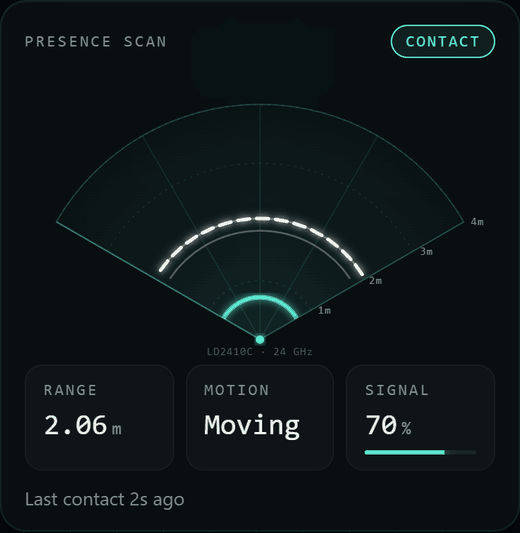
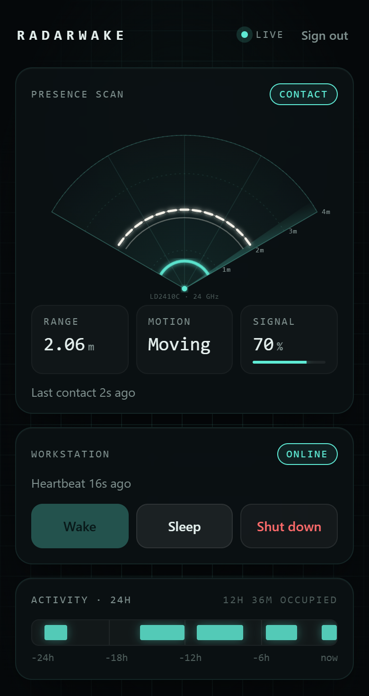
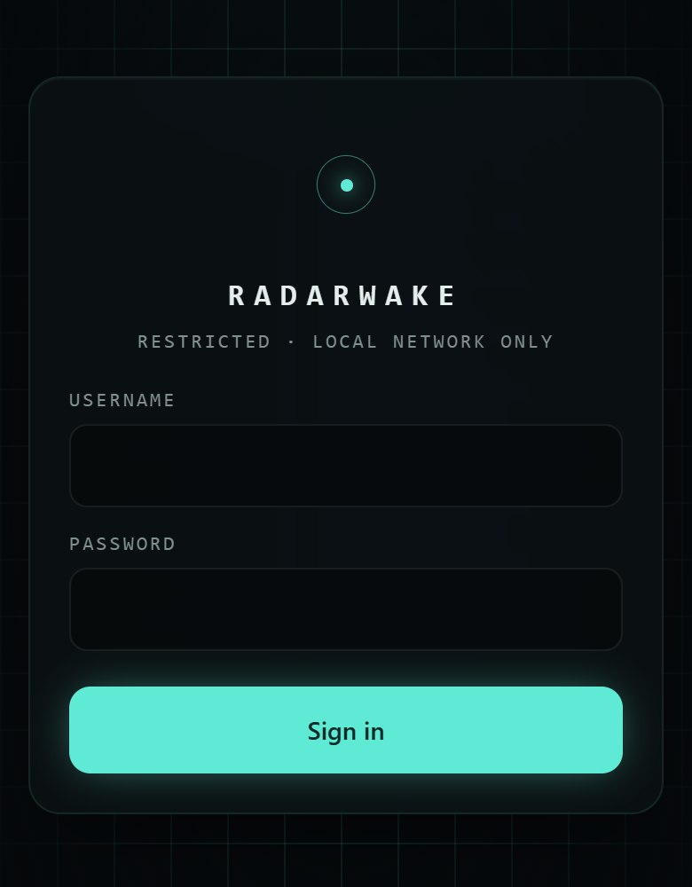
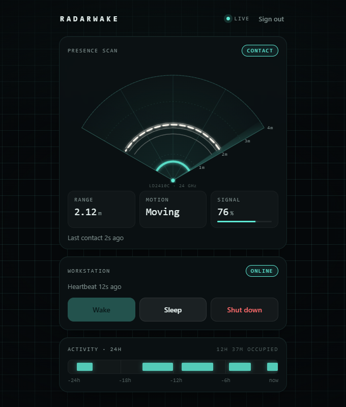
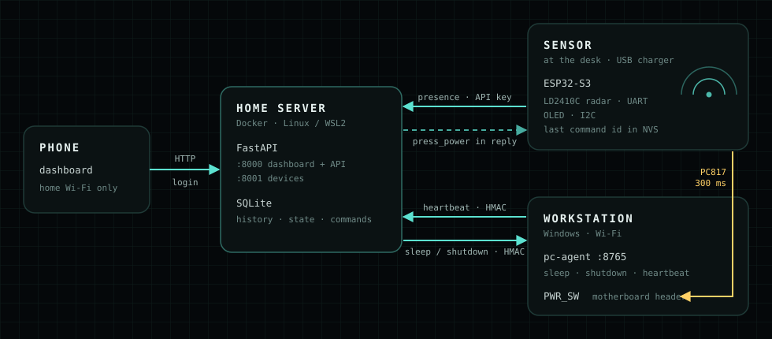
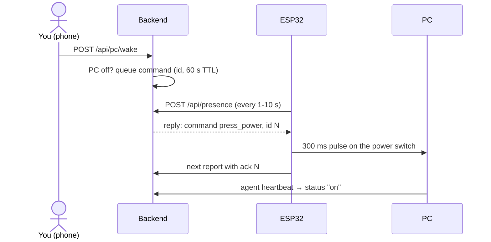
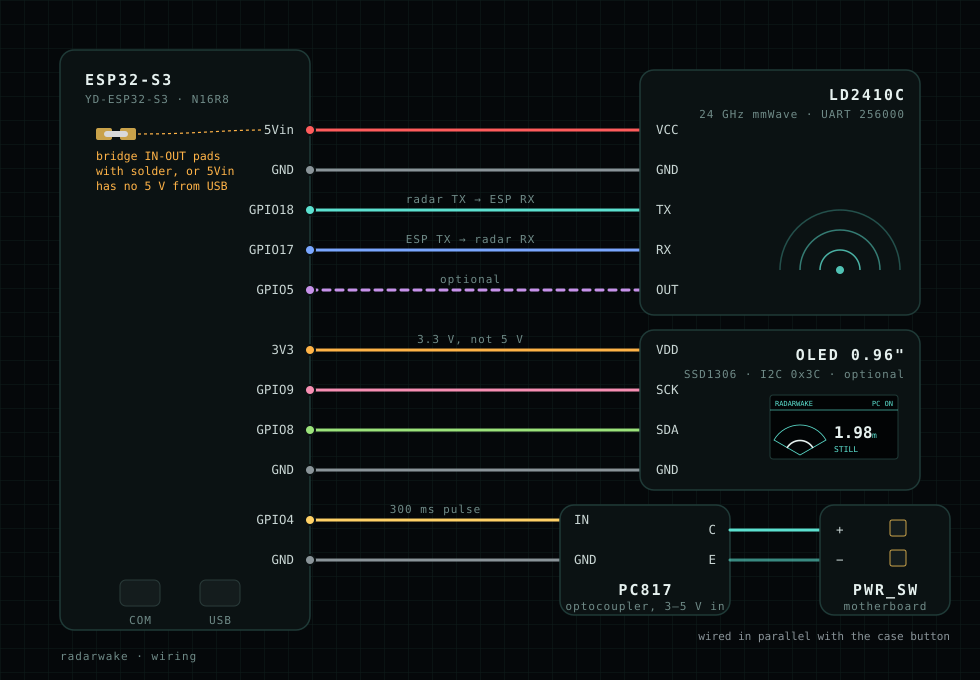

<div align="center">

# radarwake

**Presence-aware PC control with a 24 GHz mmWave radar.**
See who is at the desk, and wake, sleep or shut down the PC from your phone.

[](https://github.com/AkoSuminoe/radarwake/actions/workflows/ci.yml)
[](https://github.com/AkoSuminoe/radarwake/releases/latest)
[](LICENSE)




<sub>Live dashboard fed by the LD2410C radar. The radar measures range, not bearing, so a
target is drawn as an arc at its distance, with a fading echo trail.</sub>

</div>

## Overview

Wake-on-LAN does not work reliably on a Wi-Fi-only desktop, and leaving the PC on all day
wastes power. radarwake solves both with hardware: an **ESP32-S3** next to the desk reads
an **LD2410C mmWave radar**, reports presence to a small server on the home network, and,
when asked, **presses the motherboard's power button through an optocoupler**. A signed
agent on the PC handles sleep and shutdown, and a password-protected dashboard ties it
together.

The project spans the full stack: embedded C++ firmware, a hardened Python API, a React
dashboard, a Windows service, Docker packaging, CI and release automation.

<table>
  <tr>
    <td align="center" width="33%"><br><sub><b>Phone dashboard</b></sub></td>
    <td align="center" width="33%"><br><sub><b>LAN-only login</b></sub></td>
    <td align="center" width="33%"><br><sub><b>Desktop view</b></sub></td>
  </tr>
</table>

## Features

- **Live sonar view:** range, motion and signal strength, updated every second while
  someone is present, with a 24 h occupancy timeline.
- **Real power-button wake:** works from off, sleep or hibernate, and on Wi-Fi PCs where
  Wake-on-LAN does not.
- **Sleep / shut down from the phone** through an HMAC-signed agent on the PC.
- **OLED status screen** on the sensor with a mini sonar and the distance (optional).
- **Private by design:** home network only, argon2 password login, authenticated device
  traffic, replay protection, read-only non-root container.
- **One-line installers** for the server (Linux / WSL2) and the Windows agent, built and
  published by GitHub Actions.

## Tech stack

| Layer | Technology |
|---|---|
| Firmware | ESP32-S3, Arduino core 2.x on PlatformIO, LD2410C over UART, U8g2 (OLED), NVS |
| Backend | Python 3.12, FastAPI, SQLAlchemy 2 + SQLite, PyJWT, argon2 (pwdlib) |
| Dashboard | Next.js 15 static export, React 19, hand-drawn SVG sonar |
| PC agent | Python standard library, packaged as a standalone `.exe` (PyInstaller) |
| Ops | Docker multi-stage build, multi-arch image on GHCR, GitHub Actions CI + releases |

## Quick start

**1. Server** (always-on Linux box, Raspberry Pi or WSL2 with Docker):

```bash
curl -fsSL https://raw.githubusercontent.com/AkoSuminoe/radarwake/main/scripts/install.sh | bash
```

It asks for the server's LAN IP, the PC's IP and a dashboard password, generates all
secrets and starts the container. Run it again any time to update.

If the server is a Windows machine running WSL2, also run this once in an elevated
PowerShell on Windows (mirrored networking, firewall, start at boot):

```powershell
irm https://github.com/AkoSuminoe/radarwake/releases/latest/download/wsl-server-setup.ps1 | iex
```

**2. Workstation agent** (the PC you want to wake/sleep), elevated PowerShell:

```powershell
irm https://github.com/AkoSuminoe/radarwake/releases/latest/download/get-agent.ps1 | iex
```

Enter the server IP and the agent secret printed by the server installer. No Python
needed; the agent runs at boot as a background task. Remove it with
`& "$env:ProgramFiles\radarwake-agent\uninstall.ps1"`.

**3. Sensor:** wire it up (see [Hardware](#hardware)), put the Wi-Fi details, the server
URL and the ESP32 API key into `firmware/src/config.h` and flash it
(see [Firmware](#firmware)).

**4. Phone:** open `http://<server-ip>:8000` on the home Wi-Fi and sign in. In Safari,
Share → **Add to Home Screen** opens it like an app.

## How it works

<p align="center"></p>

**Waking the PC.** The ESP32 never listens on a port; commands ride on the reply to its
regular report.



- **Is the PC on?** Yes if the pc-agent heartbeat is newer than 90 s. Wake is refused
  (409) while the PC is on, so a running PC never gets a button press.
- **Sleep / shut down:** the backend sends an HMAC-signed request to the agent.
- **Reports:** every second while someone is present, every 10 s otherwise. History is
  written to the database only on changes or once a minute.

## Hardware

<p align="center"></p>

| Part | Notes |
|---|---|
| ESP32-S3 dev board | YD-ESP32-S3 N16R8 (DevKitC-style, two USB-C ports) |
| HLK-LD2410C | 24 GHz mmWave presence radar, 5 V |
| PC817 optocoupler module | 1 channel, rated for 3-5 V input |
| 0.96" OLED (optional) | SSD1306 128×64, I2C (1.3" SH1106 also supported) |
| Dupont wires, 5 V USB charger | the charger keeps the sensor alive while the PC is off |

> [!WARNING]
> **Solder the `IN-OUT` pads on the YD-ESP32-S3.** On this board the `5Vin` pin is not
> connected to USB 5 V out of the box, so the radar gets no power and stays dark (no
> data, no Bluetooth advertising). Next to the `5Vin` pin there are two small pads marked
> **IN** and **OUT**: unplug the board, bridge them with a blob of solder, check there is
> no short to neighbouring pins, then power up. Afterwards `5Vin` carries 5 V from USB.
> A quick test before soldering: power the radar from `3V3` for a moment; if data
> arrives, the missing 5 V was the problem.

**LD2410C radar**

| LD2410C | ESP32-S3 |
|---|---|
| VCC | 5Vin (after the solder bridge) |
| GND | GND |
| TX  | GPIO18 |
| RX  | GPIO17 |
| OUT | GPIO5 (optional) |

The firmware scans both pin directions and common baud rates at boot, so swapped TX/RX
still works.

**0.96" OLED (optional)**

| OLED | ESP32-S3 |
|---|---|
| GND | GND |
| VDD | **3V3** (not 5 V) |
| SCK | GPIO9 |
| SDA | GPIO8 |

Shows a mini sonar, the distance, motion state, signal strength, Wi-Fi bars and PC state.
It turns off after 5 minutes with nobody around and shifts by a pixel every minute to
limit burn-in. For 1.3" SH1106 panels add `#define OLED_SH1106` to `config.h`. Without a
display the firmware logs `[oled] ekran bulunamadi` and carries on.

**PC817 optocoupler → power switch**

| From | To |
|---|---|
| ESP GPIO4 | module IN |
| ESP GND | module GND (input side) |
| module output, collector | motherboard PWR_SW + |
| module output, emitter | motherboard PWR_SW − |

Wire it in parallel with the case button so that keeps working. The optocoupler keeps
the ESP32 and the PC electrically isolated. Until it is installed, a wake command only
lights the board's RGB LED blue.

**Power and USB.** Flash through the port labelled **USB** (native USB-Serial/JTAG). For
permanent use, plug the board into a 5 V USB charger, not into the workstation (its USB
power drops when the PC is off). Pins to avoid: 0/3/45/46 (strapping), 19/20 (native USB),
43/44 (UART0), 35-37 (octal PSRAM).

## Setup in detail

### Firmware

1. Copy `firmware/src/config.example.h` to `config.h` and fill in Wi-Fi (2.4 GHz), the
   server LAN IP and `API_KEY` (printed by the server installer).
2. Connect the **USB** port and run `pio run -t upload -t monitor`
   (if `pio` is not on PATH: `~/.platformio/penv/Scripts/pio`). The first flash may need
   BOOT held while tapping RST.
3. Expect `[radar] RX=GPIO18 256000 baud ... <- valid frame` and `[report] ... -> 200`.

The firmware is not shipped as a binary because Wi-Fi credentials and the API key are
compiled in.

<details>
<summary><b>Server, manual setup</b> (what <code>install.sh</code> does)</summary>

```bash
cd backend
python -m venv .venv && .venv/bin/pip install pwdlib[argon2]
.venv/bin/python scripts/hash_password.py   # prints ADMIN_PASSWORD_HASH and secrets
cp .env.example .env                        # fill in the values
cd .. && cp .env.example .env               # LAN_IP=<server LAN IP>
docker compose up -d --build
```

- Ports 8000 (dashboard) and 8001 (ESP32 + agent) are bound to `LAN_IP` only.
- On WSL2 with native Docker use `networkingMode=mirrored` and allow 8000/8001 from the
  LAN subnet in both the Hyper-V firewall and Windows Firewall
  (`scripts/wsl-server-setup.ps1`). Enable systemd in WSL so Docker starts with the distro.
- Prebuilt image: `ghcr.io/akosuminoe/radarwake` (amd64, arm64); `--build` builds from source.
- Reserve DHCP addresses for the server, the workstation and the ESP32.

</details>

<details>
<summary><b>pc-agent, manual setup</b></summary>

`get-agent.ps1` downloads the release zip and runs the installer. From a checkout (uses
`agent.py` + python.org Python instead of the exe):

```powershell
cd pc-agent
powershell -ExecutionPolicy Bypass -File .\install.ps1 -ServerIp <server-ip> -PowerButtonDoNothing -DisableHibernate
```

- Installs to `C:\Program Files\radarwake-agent`; `config.json` there is readable by
  Administrators and SYSTEM only. Prompts for the secret if no config exists.
- Runs at boot as SYSTEM (before login), restarts on failure, firewall-limited to the server.
- `-PowerButtonDoNothing`: a stray press on a running PC does nothing; waking from sleep or
  power-on from off still works because that is handled by the firmware.
- `-DisableHibernate`: makes "sleep" a real S3 sleep instead of hibernation.

</details>

<details>
<summary><b>Troubleshooting</b></summary>

| Symptom | Fix |
|---|---|
| Radar LED off, `[radar]` finds no frames | `5Vin` has no power: solder the `IN-OUT` pads (see Hardware) |
| ESP32 Wi-Fi fails with `reason=15` | Change the router's 2.4 GHz wireless mode (EE Smart Hub: Mode 2), set a fixed channel, turn WPS off, restart the router |
| Dashboard unreachable from the phone | Phone not on home Wi-Fi, or WSL firewall / mirrored mode missing |
| Workstation shows offline | Agent not running (`agent.log`), network set to Public, or wrong secret |
| `[oled] ekran bulunamadi` | Check SDA/SCK wiring and that VDD is on 3V3 |

</details>

<details>
<summary><b>API</b></summary>

| Endpoint | Port | Auth | Notes |
|---|---|---|---|
| `POST /api/auth/login` | 8000 | - | JWT + httpOnly cookie, rate limited |
| `POST /api/auth/logout` | 8000 | - | clears the cookie |
| `GET  /api/auth/me` | 8000 | JWT | session check |
| `GET  /api/presence/live` | 8000 | JWT | latest radar reading (in memory) |
| `GET  /api/presence/current` | 8000 | JWT | debounced presence + sensor state |
| `GET  /api/presence/history?hours=24` | 8000 | JWT | timeline data |
| `GET  /api/pc/status` | 8000 | JWT | `on` / `off` / `waking` |
| `POST /api/pc/wake` | 8000 | JWT | only while off; 409 otherwise |
| `POST /api/pc/sleep` | 8000 | JWT | `{"action":"sleep"\|"shutdown"}` |
| `POST /api/presence` | 8001 | `X-API-Key` | ESP32 report; reply carries commands + PC state |
| `POST /api/pc/heartbeat` | 8001 | HMAC | pc-agent |
| `GET  /api/health` | both | - | healthcheck |

Each route is only served on its own port; the other port returns 404.

</details>

## Security decisions

- **No unauthenticated endpoint can trigger a power action.** Every state-changing route
  requires a JWT, an API key or an HMAC signature.
- **Nothing is exposed to the internet.** Both ports are bound to the server's LAN IP;
  no tunnel or port forwarding. The Tailscale interface is excluded as well.
- **Host header allow-list** (`ALLOWED_HOSTS`) against DNS rebinding. Rate limiting uses the
  socket address and ignores forwarding headers.
- **A running PC never gets a power-button press.** Wake returns 409 while a heartbeat is
  present or a press is in flight. The ESP32 stores the last executed command id in NVS so
  a resend after a reboot is never executed twice. The pulse is 300 ms, far from a 5 s
  forced power-off.
- **The ESP32 endpoint is authenticated**, because fake presence data could drive the
  automatic sleep/wake logic.
- **pc-agent commands are HMAC-signed** with a ±30 s window and a nonce cache against replay,
  and the agent's firewall rule only admits the server.
- **Dashboard session:** argon2-hashed password (min. 12 characters), JWT in an httpOnly,
  SameSite=Strict cookie, plus a required `X-Radarwake` header on cookie-authenticated POSTs.
- **Plain HTTP on the LAN is a deliberate trade-off.** Traffic stays inside the WPA2-encrypted
  home Wi-Fi; HTTPS with a local certificate can be added later (`COOKIE_SECURE=true`).
- **Container hardening:** read-only filesystem, `cap_drop: ALL`, `no-new-privileges`,
  non-root user.
- **Secrets never enter the repo** (`.env`, `config.h` and `config.json` are git-ignored).
- **Automatic sleep and wake are off by default** (`AUTO_SLEEP_ENABLED`, `AUTO_WAKE_ENABLED`);
  enable them after manual testing.

Report vulnerabilities privately, see [SECURITY.md](SECURITY.md).

## Repository layout

```
firmware/   ESP32-S3 firmware (PlatformIO, Arduino core 2.x)
backend/    FastAPI service (Docker on the server)
frontend/   Next.js dashboard (static export, bundled into the backend image)
pc-agent/   sleep/shutdown + heartbeat agent for the workstation (Windows)
scripts/    one-line installers (server, WSL2 host, agent)
docs/       images
```

Releases are built by GitHub Actions on every `v*` tag: the Windows agent exe/zip, the
multi-arch container image and the installer scripts. See [CHANGELOG.md](CHANGELOG.md).

## Development

```bash
cd backend && pip install -r requirements-dev.txt && python -m pytest -q   # API tests
cd frontend && npm install && npm run build                                # dashboard -> out/
cd firmware && pio run                                                     # firmware
```

For a local dashboard run, copy `frontend/out` to `backend/static` and start the backend.
CI runs all three plus `shellcheck` and a PowerShell parse check on every push.

## Roadmap

- [x] Backend: auth, SQLite, Docker Compose, power command queue
- [x] Firmware: LD2410C, authenticated reports, power-button pulse, OLED
- [x] pc-agent: heartbeat, signed sleep/shutdown, standalone exe
- [x] Dashboard: live sonar, workstation controls, 24 h activity
- [x] LAN-only deployment, one-line installers, release pipeline
- [ ] Optocoupler install and end-to-end wake test
- [ ] Radar tuning and LD2410C engineering mode for per-zone detection (desk vs. bed)
- [ ] Phone control over BLE directly to the ESP32

## License

[MIT](LICENSE)
